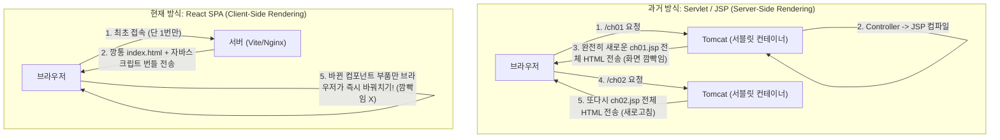
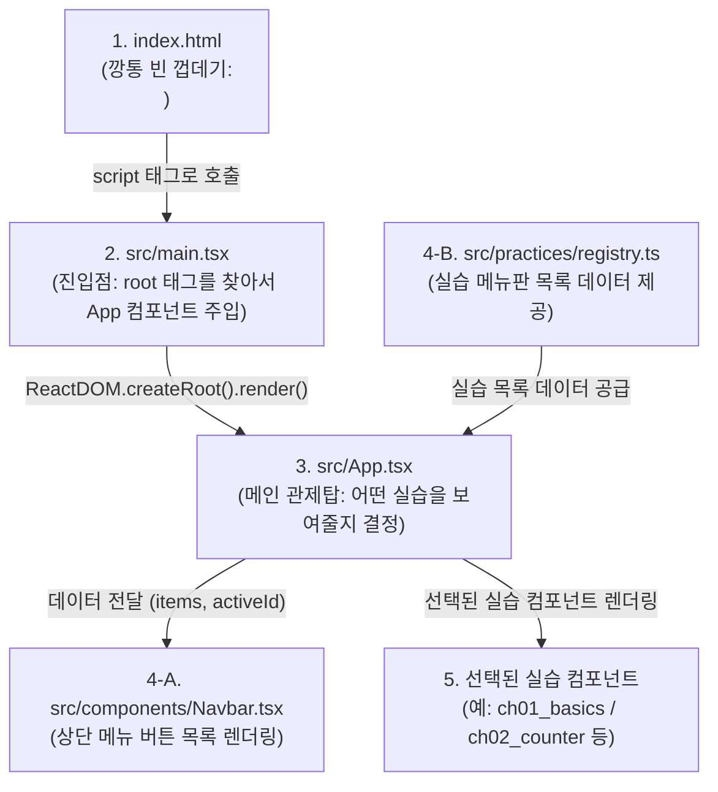
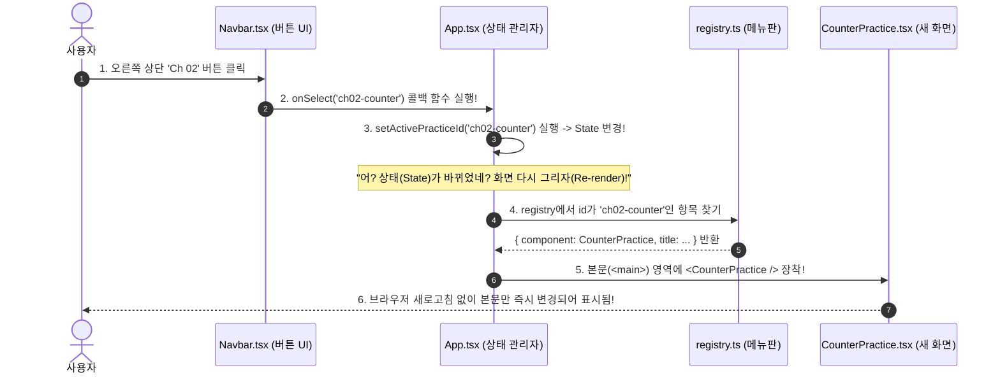

# [입문 & 개념 가이드] 0. 리액트 전체 실행 흐름과 아키텍처 (with Servlet / Spring MVC 비교)

이 문서는 **Servlet, JSP, Spring MVC 환경에 익숙한 백엔드 개발자 및 입문자가 리액트(React)의 구동 원리와 현재 프로젝트의 구조를 가장 직관적으로 이해할 수 있도록 작성된 '0번' 가이드**입니다.

브라우저가 처음 열릴 때부터 화면이 그려지기까지의 전체 흐름, 그리고 **"오른쪽 상단 버튼을 클릭했을 때 어떻게 페이지 이동 없이 실습 화면(Ch 01, Ch 02 등)이 싹 바뀌는가?"**의 비밀을 파일 간의 연관관계를 통해 명쾌하게 설명합니다.

---

## 📌 목차
1. [패러다임의 전환: 서블릿/JSP vs 리액트(SPA)](#1-패러다임의-전환-서블릿jsp-vs-리액트spa)
2. [전체 실행 흐름도 (index.html부터 화면 렌더링까지)](#2-전체-실행-흐름도-indexhtml부터-화면-렌더링까지)
3. [파일별 역할 및 Spring MVC 1:1 매핑표](#3-파일별-역할-및-spring-mvc-11-매핑표)
4. [핵심 질문: "상단 버튼을 누르면 화면이 바뀌는 원리는 어디에 있는가?"](#4-핵심-질문-상단-버튼을-누르면-화면이-바뀌는-원리는-어디에-있는가)
5. [코드 추적: 3개 파일이 맞물려 돌아가는 연결 고리](#5-코드-추적-3개-파일이-맞물려-돌아가는-연결-고리)
6. [정리: 새로운 실습(ch03)을 만들면 어떻게 동작하는가?](#6-정리-새로운-실습ch03을-만들면-어떻게-동작하는가)

---

## 1. 패러다임의 전환: 서블릿/JSP vs 리액트(SPA)

가장 먼저 머릿속에 있는 **"웹 동작 방식"**을 살짝 바꿔야 합니다.



- **JSP/Servlet 방식**:
  - 버튼을 누르면 브라우저 주소창이 바뀌면서 톰캣 서버로 새 HTTP GET 요청이 갑니다.
  - 톰캣이 `ch02.jsp`를 읽어 HTML 문자열을 새로 만들어서 브라우저에 던져주고, 브라우저는 **화면 전체를 흰색으로 새로고침(Reload)**합니다.
- **리액트(SPA) 방식**:
  - 브라우저는 서버에서 HTML을 딱 **한 장(`index.html`)**만 받습니다.
  - 상단 버튼을 눌러도 **톰캣이나 서버로 아무 요청도 가지 않습니다.**
  - 브라우저 안에서 동작하는 **자바스크립트(리액트 엔진)가 메모리 상에서 화면의 일부분(본문 부품)만 쏙 빼내고 새 부품을 끼워 넣는 것**입니다.

---

## 2. 전체 실행 흐름도 (index.html부터 화면 렌더링까지)

프로젝트가 시작될 때 파일들이 어떤 순서로 호출되는지 나타낸 지도입니다:



---

## 3. 파일별 역할 및 Spring MVC 1:1 매핑표

기존에 알고 계시던 Java/Spring Web 기술과 비교하면 이해가 훨씬 빠릅니다.

| 파일 경로 | 리액트에서의 역할 | Spring MVC / Servlet 비유 |
| :--- | :--- | :--- |
| [`index.html`](file:///C:/Users/user/Documents/GitHub/React_practice/index.html) | 앱이 최초로 내려받는 유일한 HTML 파일 (`<div id="root">`) | `mainLayout.jsp`의 최외곽 뼈대 |
| [`src/main.tsx`](file:///C:/Users/user/Documents/GitHub/React_practice/src/main.tsx) | 앱의 실행 진입점. React를 브라우저 DOM(`root`)에 부팅 | `web.xml` 또는 `DispatcherServlet`의 초기화 코드 |
| [`src/App.tsx`](file:///C:/Users/user/Documents/GitHub/React_practice/src/App.tsx) | **메인 사령탑(Controller)**. 현재 선택된 탭 번호를 기억하고 부품들을 조립 | `@Controller` + 메인 대시보드 뷰(`dashboard.jsp`) |
| [`src/components/Navbar.tsx`](file:///C:/Users/user/Documents/GitHub/React_practice/src/components/Navbar.tsx) | 상단 메뉴 바 UI. 버튼 클릭 시 App에 "선택 바뀜" 통보 | `<jsp:include page="header.jsp" />` (GNB 헤더) |
| [`src/practices/registry.ts`](file:///C:/Users/user/Documents/GitHub/React_practice/src/practices/registry.ts) | 등록된 모든 실습의 목록(ID, 제목, 컴포넌트 매핑 테이블) | Spring의 `HandlerMapping` (URL ↔ 컨트롤러 매핑 목록) |
| [`src/types/practice.ts`](file:///C:/Users/user/Documents/GitHub/React_practice/src/types/practice.ts) | 실습 데이터가 가져야 할 규격(타입 정의) | Java의 `PracticeDTO` 또는 `PracticeVO` 클래스 |
| `src/practices/ch01_...` | 각 챕터별 실제 실습 화면들 | 개별 업무 화면 JSP (`boardList.jsp`, `detail.jsp`) |

---

## 4. 핵심 질문: "상단 버튼을 누르면 화면이 바뀌는 원리는 어디에 있는가?"

> **"오른쪽 상단에 Ch 01, Ch 02 버튼을 누르면 페이지가 바뀌는데, 걔네들은 어디서 구현한 건가요?"**

이 동작은 단 하나의 파일이 아니라, **아래 3개 파일의 유기적인 '분업 협력'**으로 구현되어 있습니다!



---

## 5. 코드 추적: 3개 파일이 맞물려 돌아가는 연결 고리

실제 프로젝트의 코드를 보면서 어떻게 연결되어 있는지 한눈에 확인해 보세요.

### ① 메뉴판 정의: [`src/practices/registry.ts`](file:///C:/Users/user/Documents/GitHub/React_practice/src/practices/registry.ts)
"어떤 버튼이 있고, 그 버튼을 누르면 어떤 화면 컴포넌트를 띄워야 하는가?"를 배열로 적어둔 곳입니다:

```typescript
export const practiceRegistry: PracticeItem[] = [
  {
    id: 'ch01-basics',
    chapter: 'Ch 01',
    title: 'JSX 기초 & 가상 DOM',
    component: JsxBasicsPractice, // 👈 띄울 컴포넌트 부품
  },
  {
    id: 'ch02-counter',
    chapter: 'Ch 02',
    title: 'Props & State 카운터',
    component: CounterPractice,   // 👈 띄울 컴포넌트 부품
  },
];
```

---

### ② 버튼 렌더링 & 클릭 감지: [`src/components/Navbar.tsx`](file:///C:/Users/user/Documents/GitHub/React_practice/src/components/Navbar.tsx)
상단 바는 메뉴판 목록(`items`)을 받아서 `map()` 반복문으로 버튼들을 쭉 화면에 그립니다.
그리고 사용자가 버튼을 클릭하면 `onClick={() => onSelect(item.id)}`를 통해 부모(App)에게 신호를 보냅니다.

```tsx
<nav className="navbar-menu">
  {items.map((item) => {
    const isActive = item.id === activeId; // 지금 선택된 버튼인지 확인 (파란색 불 켜기)
    return (
      <button
        key={item.id}
        className={`nav-tab-btn ${isActive ? 'active' : ''}`}
        onClick={() => onSelect(item.id)} // 👈 [핵심] 클릭하면 부모(App)의 함수를 호출!
      >
        <span className="tab-chapter">{item.chapter}</span>
        <span className="tab-title">{item.title}</span>
      </button>
    );
  })}
</nav>
```

---

### ③ 메인 조율 & 화면 교체: [`src/App.tsx`](file:///C:/Users/user/Documents/GitHub/React_practice/src/App.tsx)
모든 마법이 일어나는 중심지입니다.
JSP에서는 파라미터(`?menu=ch02`)를 받아 `if-else`로 JSP를 include했다면, **리액트에서는 `useState`라는 상태값으로 제어**합니다.

```tsx
export const App: React.FC = () => {
  // 1. 현재 선택된 실습 ID를 기억하는 '상태(State)' 변수
  // (Spring MVC의 Session이나 request.setAttribute 같은 보관소 역할)
  const [activePracticeId, setActivePracticeId] = useState<string>('ch01-basics');

  // 2. 현재 선택된 ID를 가진 실습 객체와 컴포넌트를 메뉴판에서 찾음
  const currentPractice = practiceRegistry.find(item => item.id === activePracticeId);
  const ActiveComponent = currentPractice?.component; // 예: CounterPractice

  return (
    <div className="app-layout">
      {/* 3. Navbar에게 메뉴판 목록과 클릭 시 실행할 함수(onSelect)를 넘겨줌 */}
      <Navbar
        items={practiceRegistry}
        activeId={activePracticeId}
        onSelect={(id) => setActivePracticeId(id)} // 👈 버튼 누르면 이 함수가 실행되어 ID가 바뀜!
      />

      {/* 4. 본문 영역: 현재 선택된 컴포넌트만 태그 형태로 끼워 넣음 */}
      <main className="main-content">
        <div className="practice-stage">
          {/* ActiveComponent가 CounterPractice면 <CounterPractice /> 로 변신! */}
          {ActiveComponent ? <ActiveComponent /> : <p>실습 없음</p>}
        </div>
      </main>
    </div>
  );
};
```

> 💡 **이해를 돕는 한 줄 포인트**:  
> `onSelect={(id) => setActivePracticeId(id)}`  
> 사용자가 버튼을 클릭하면 `setActivePracticeId('ch02-counter')`가 실행됩니다.  
> **리액트는 State가 변경되면 `App` 컴포넌트를 즉각 재실행(Re-render)**하여 본문 자리에 `CounterPractice`를 갈아 끼웁니다!

---

## 6. 정리: 새로운 실습(ch03)을 만들면 어떻게 동작하는가?

이제 전체 구조를 알았으니, 새로운 실습 컴포넌트를 추가할 때 왜 2단계만 거치면 끝나는지 이해할 수 있습니다:

1. **실습 컴포넌트 제작**:
   - `src/practices/ch03_todo/TodoPractice.tsx` 생성
2. **메뉴판([`registry.ts`](file:///C:/Users/user/Documents/GitHub/React_practice/src/practices/registry.ts))에 1줄 등록**:
   ```typescript
   {
     id: 'ch03-todo',
     chapter: 'Ch 03',
     title: '할 일 관리 앱',
     description: '배열 State 조작 및 폼 제어',
     component: TodoPractice,
   }
   ```
3. **끝!**:
   - `App.tsx`나 `Navbar.tsx`는 손댈 필요가 없습니다.
   - `Navbar`가 `registry.ts`의 늘어난 배열을 자동으로 읽어서 상단 오른쪽에 **'Ch 03'** 버튼을 새로 만듭니다.
   - 그 버튼을 클릭하면 `App`이 알아서 `TodoPractice`를 본문에 띄워줍니다.

이것이 바로 리액트의 **컴포넌트 조립형(Lego Block) 아키텍처**입니다.
이 구조를 머릿속에 담아두시면 앞으로 어떤 실습을 만들더라도 흔들리지 않고 개발하실 수 있습니다!
