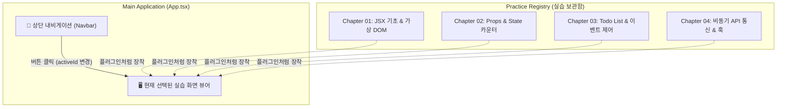
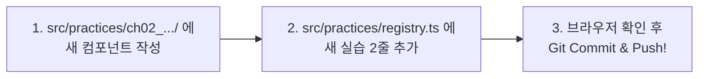

# [실습 & 아키텍처 가이드] React 누적형 실습 프로젝트 구축 및 기능 확장 가이드

이 문서는 **리액트(React)를 처음 시작하는 학습자가 매일 배운 개념과 실습을 별도의 프로젝트로 쪼개지 않고, 하나의 완성도 높은 '나만의 리액트 학습 놀이터(Playground) / 대시보드' 웹 애플리케이션으로 차곡차곡 누적해 나갈 수 있도록 돕는 실습 & 구조 설계 가이드**입니다.

이전 `1.JSP_LOGIN_GUIDE.md` 및 `4.JSP_FEED_BOARD_GUIDE.md`에서 보여드렸던 양식과 동일하게, **필요 개념 → 폴더/파일 배치도(`[신규 생성]`, `[기존 유지]`, `[수정]`) → 완벽한 `.gitignore` → 단계별 소스코드 및 친절한 한 줄 해설 → 매 실습마다 기능을 안전하게 덧붙이는 표준 루틴** 순서로 구성되었습니다.

---

## 📌 목차

1. [누적형 아키텍처 설계 원리 (Lego & Dashboard Pattern)](#1-누적형-아키텍처-설계-원리-lego--dashboard-pattern)
2. [새 프로젝트 생성 & Git / GitHub 세팅 가이드](#2-새-프로젝트-생성--git--github-세팅-가이드)
3. [완벽한 `.gitignore` 작성 및 관리 기준](#3-완벽한-gitignore-작성-및-관리-기준)
4. [프로젝트 구조 및 작업 파일 배치도](#4-프로젝트-구조-및-작업-파일-배치도)
5. [Step 1: 타입 규격 정의 (`src/types/practice.ts`)](#step-1-타입-규격-정의-srctypespracticets)
6. [Step 2: 첫 번째 실습 컴포넌트 작성 (`src/practices/ch01_basics/...`)](#step-2-첫-번째-실습-컴포넌트-작성-srcpracticesch01_basics)
7. [Step 3: 실습 자동 등록 레지스트리 (`src/practices/registry.ts`)](#step-3-실습-자동-등록-레지스트리-srcpracticesregistryts)
8. [Step 4: 상단 내비게이션 바 컴포넌트 (`src/components/Navbar.tsx`)](#step-4-상단-내비게이션-바-컴포넌트-srccomponentsnavbartsx)
9. [Step 5: 메인 대시보드 조립 (`src/App.tsx`, `src/index.css`)](#step-5-메인-대시보드-조립-srcapptsx-srcindexcss)
10. [Step 6: 실행 및 동작 테스트](#step-6-실행-및-동작-테스트)
11. [🔄 매일 새로운 실습을 추가하는 표준 루틴 (3단계 워크플로우)](#-매일-새로운-실습을-추가하는-표준-루틴-3단계-워크플로우)
12. [🚀 향후 확장 로드맵 (React Router 전환)](#-향후-확장-로드맵-react-router-전환)
13. [자주 발생하는 오류 & 체크리스트 (FAQ)](#자주-발생하는-오류--체크리스트-faq)

---

## 1. 누적형 아키텍처 설계 원리 (Lego & Dashboard Pattern)

### 💡 왜 리액트는 누적형 실습에 최적화되어 있는가?

Servlet/JSP 환경에서는 새 기능을 추가할 때 `web.xml`, 서블릿 URL 매핑(`/login`, `/board`), 공유 세션 등 여러 레이어가 맞물려 있어 구조를 신중히 유지해야 했습니다.  
반면 **리액트는 독립적인 '컴포넌트(Component, 부품)' 중심 구조**입니다.



- **장점 1: 완벽한 독립성**  
  오늘 실습하는 `Counter.tsx`에 오류가 생겨도, 어제 작성해 둔 `JsxBasics.tsx`의 코드는 전혀 영향을 받지 않습니다.
- **장점 2: 플러그인 방식(Lego Block)**  
  실습 폴더에 컴포넌트 하나를 만들고 목록(`registry.ts`)에 한 줄 등록하기만 하면, 상단 메뉴에 자동으로 버튼이 생기고 화면이 전환됩니다.
- **장점 3: 포트폴리오 자산화**  
  수업이 끝날 때쯤에는 수십 개의 리액트 핵심 기능이 한 웹페이지 안에 잘 정리된 나만의 '리액트 기능 도감(Cheat Sheet Portal)'이 완성됩니다.

---

## 2. 새 프로젝트 생성 & Git / GitHub 세팅 가이드

강의 폴더(`practice/07_01`, `07_02` 등)와 완전히 분리된 **나만의 실습 전용 폴더**를 생성하여 Git 리포지토리로 연결합니다.

### 🛠️ 1) 프로젝트 생성 명령어 (Vite + TypeScript)

터미널(PowerShell 또는 Git Bash)을 열고 원하는 작업 폴더로 이동한 뒤 실행합니다:

```powershell
# 1. Vite 프로젝트 생성 (이름: react-playground)
npm create vite@latest react-playground -- --template react-ts

# 2. 생성된 프로젝트 폴더로 이동
cd react-playground

# 3. 필수 패키지 설치
npm install

# 4. 개발 서버 정상 구동 확인 (확인 후 Ctrl + C로 종료)
npm run dev
```

> 💡 **강의 교재 호환성 참고**:  
> 현재 수업 교재(`Vite_실습_실행안내.md`)의 기준에 맞춰 React 18, TypeScript 5.x, Vite 환경으로 구성됩니다.

---

### 🐙 2) Git 초기화 및 깃허브 원격 리포지토리 연결

GitHub 웹사이트에서 `react-playground`라는 새 리포지토리(Public 또는 Private)를 생성한 후 아래 명령을 차례대로 수행합니다:

```powershell
# 1. 깃 로컬 저장소 초기화
git init

# 2. 기본 브랜치를 main으로 지정
git branch -M main

# 3. .gitignore 파일 확인 후 첫 커밋
git add .
git commit -m "feat: 프로젝트 초기 세팅 (Vite + React + TS)"

# 4. GitHub 원격 저장소 주소 연결 (본인의 깃허브 주소 입력)
git remote add origin https://github.com/<내_아이디>/react-playground.git

# 5. 첫 푸시
git push -u origin main
```

---

## 3. 완벽한 `.gitignore` 작성 및 관리 기준

리액트 프로젝트는 `npm install` 시 수백 메가바이트(MB)에 달하는 라이브러리(`node_modules`)가 생성됩니다.  
이 파일들이 깃허브에 올라가면 **커밋 속도 저하, 충돌 발생, 깃허브 용량 초과**의 원인이 되므로 반드시 철저히 무시해야 합니다.

프로젝트 루트의 `.gitignore` 파일에 아래 내용을 반드시 포함합니다.

### 📄 `.gitignore` 완성본

```gitignore
# ==========================================
# 1. 의존성 패키지 (용량이 매우 크므로 필수 제외)
# ==========================================
node_modules/
.pnp
.pnp.js

# ==========================================
# 2. 빌드 결과물 (npm run build 시 자동 생성되는 폴더)
# ==========================================
dist/
dist-ssr/
build/
*.local

# ==========================================
# 3. 환경 변수 및 보안 키 (API 키 등 유출 방지)
# ==========================================
.env
.env.development.local
.env.test.local
.env.production.local
*.env.local

# ==========================================
# 4. 로그 및 임시 캐시 파일
# ==========================================
npm-debug.log*
yarn-debug.log*
yarn-error.log*
pnpm-debug.log*
lerna-debug.log*
.vite/
.cache/

# ==========================================
# 5. 운영체제 및 IDE 전용 메타데이터
# ==========================================
.DS_Store
Thumbs.db
.idea/
.vscode/
*.suo
*.ntvs*
*.njsproj
*.sln
*.sw?
```

> ⚠️ **주의 (가장 흔한 실수)**:  
> 만약 실수로 `git add .`를 먼저 실행하여 `node_modules`가 깃에 추적되기 시작했다면, 즉시 아래 명령으로 캐시를 지운 뒤 재커밋해야 합니다.  
> `git rm -r --cached node_modules` ➜ `git commit -m "fix: node_modules git 추적 제거"`

---

## 4. 프로젝트 구조 및 작업 파일 배치도

새로 만들 프로젝트(`react-playground`)의 권장 디렉터리 구조입니다.  
`4.JSP_FEED_BOARD_GUIDE.md`의 규칙에 맞춰 상태 표기를 적용했습니다.

```text
react-playground/
 ├── index.html                           [기존 수정] 웹 브라우저 타이틀 변경
 ├── package.json                         (기존 유지) 의존성 및 실행 스크립트
 ├── tsconfig.json                        (기존 유지) 타입스크립트 컴파일러 설정
 ├── vite.config.ts                       (기존 유지) Vite 설정 파일
 ├── .gitignore                           [기존 수정] 필수 제외 파일 및 폴더 등록
 └── src/
      ├── main.tsx                        (기존 유지) React 루트 렌더러 진입점
      ├── index.css                       [기존 수정] 누적 실습 대시보드 전용 공통 스타일
      ├── App.tsx                         [기존 수정] 대시보드 레이아웃 & 실습 전환 허브
      │
      ├── types/
      │    └── practice.ts                [신규 생성] 실습 메타데이터(아이디, 제목, 챕터) 인터페이스
      │
      ├── components/
      │    └── Navbar.tsx                 [신규 생성] 상단 챕터별 실습 전환 내비게이션 바
      │
      └── practices/
           ├── registry.ts                [신규 생성] 모든 실습 컴포넌트를 한곳에 모아두는 목록 레지스트리
           │
           ├── ch01_basics/               [신규 생성] 1일차 실습: JSX 문법 & 가상 DOM
           │    └── JsxBasicsPractice.tsx [신규 생성] 첫 번째 실습 컴포넌트
           │
           └── ch02_state_props/          [추후 확장] 2일차 실습: State & Props 카운터 (예시)
                └── CounterPractice.tsx   [추후 확장]
```

---

## Step 1: 타입 규격 정의 (`src/types/practice.ts`)

### 📌 파일 역할
각 실습 모듈이 가져야 할 **식별자(ID), 제목(Title), 챕터(Chapter), 컴포넌트(Component), 설명(Description)**의 데이터 규격을 정의합니다.

- **위치**: `src/types/practice.ts` (신규 생성)

```typescript
import React from 'react';

/**
 * 실습 항목 하나의 정보 규격
 */
export interface PracticeItem {
  id: string;                         // 고유 식별자 (예: 'ch01-basics')
  title: string;                      // 화면에 노출될 실습 제목
  chapter: string;                    // 소속 챕터 (예: 'Chapter 01')
  description: string;                // 실습 핵심 내용 요약
  component: React.ComponentType;     // 실제 화면에 렌더링될 리액트 컴포넌트
}
```

---

## Step 2: 첫 번째 실습 컴포넌트 작성 (`src/practices/ch01_basics/...`)

### 📌 파일 역할
오늘 처음 학습한 JSX 문법과 가상 DOM 렌더링을 확인해보는 독립된 실습 컴포넌트입니다.

- **위치**: `src/practices/ch01_basics/JsxBasicsPractice.tsx` (신규 생성)

```tsx
import React, { useState } from 'react';

/**
 * Chapter 01: JSX 기본 문법 & 실시간 인터랙션 실습
 */
export const JsxBasicsPractice: React.FC = () => {
  // 간단한 상태(State)를 사용하여 리액트의 화면 갱신 원리 체험
  const [name, setName] = useState<string>('리액트 새싹');
  const [clickCount, setClickCount] = useState<number>(0);

  const currentDate = new Date().toLocaleDateString('ko-KR', {
    year: 'numeric',
    month: 'long',
    day: 'numeric',
  });

  return (
    <div className="practice-card">
      <div className="card-header">
        <span className="badge">Chapter 01 실습</span>
        <h3>🌱 JSX 기초 문법 및 반응형 렌더링</h3>
      </div>

      <p className="description">
        기존 서블릿의 JSP와 달리, 리액트는 HTML과 자바스크립트가 합쳐진 <strong>JSX(TSX)</strong>를 사용하여
        새로고침 없이 가상 DOM(Virtual DOM)으로 변경된 부분만 즉시 갱신합니다.
      </p>

      <hr className="divider" />

      {/* 1. 표현식 삽입 실습 */}
      <div className="practice-section">
        <h4>1. JSX 표현식 삽입 실습</h4>
        <div className="input-group">
          <label htmlFor="user-name">학습자 이름: </label>
          <input
            id="user-name"
            type="text"
            value={name}
            onChange={(e) => setName(e.target.value)}
            placeholder="이름을 입력하세요"
          />
        </div>
        <p className="result-text">
          반갑습니다, <strong>{name || '익명'}</strong>님! 오늘 날짜는 <span>{currentDate}</span>입니다.
        </p>
      </div>

      {/* 2. 이벤트와 상태 갱신 실습 */}
      <div className="practice-section">
        <h4>2. 가상 DOM 반응성 테스트</h4>
        <p>버튼을 클릭하면 전체 화면을 새로고침하지 않고 숫자만 즉시 올라갑니다.</p>
        <button
          className="btn-primary"
          onClick={() => setClickCount(prev => prev + 1)}
        >
          클릭 횟수: {clickCount}회
        </button>
        {clickCount >= 5 && (
          <p className="congrats-text">🎉 벌써 5번 이상 클릭하셨네요! 리액트의 반응형 렌더링이 잘 작동하고 있습니다.</p>
        )}
      </div>
    </div>
  );
};
```

---

## Step 3: 실습 자동 등록 레지스트리 (`src/practices/registry.ts`)

### 📌 파일 역할
모든 실습 컴포넌트를 한곳에 모아 배열로 보관하는 **'실습 보관함'**입니다.  
**앞으로 매일 실습이 추가될 때마다 이 파일에 새 실습을 2줄(import 및 목록 추가)만 작성하면 대시보드에 자동으로 연결됩니다.**

- **위치**: `src/practices/registry.ts` (신규 생성)

```typescript
import { PracticeItem } from '../types/practice';
import { JsxBasicsPractice } from './ch01_basics/JsxBasicsPractice';

/**
 * 실습 목록 등록소 (새 실습 컴포넌트를 만들면 여기에 추가합니다)
 */
export const practiceRegistry: PracticeItem[] = [
  {
    id: 'ch01-basics',
    title: 'JSX 기초 & 가상 DOM',
    chapter: 'Ch 01',
    description: 'JSX 문법, 표현식 바인딩, 가상 DOM의 즉각적 렌더링 원리',
    component: JsxBasicsPractice,
  },
  // [다음 실습 추가 예시]:
  // {
  //   id: 'ch02-counter',
  //   title: 'Props & State 카운터',
  //   chapter: 'Ch 02',
  //   description: '컴포넌트 간 데이터 전달과 useState 훅을 통한 상태 관리',
  //   component: CounterPractice,
  // },
];
```

---

## Step 4: 상단 내비게이션 바 컴포넌트 (`src/components/Navbar.tsx`)

### 📌 파일 역할
화면 상단에 등록된 실습 목록을 가로 탭 버튼으로 나열하고, 사용자가 원하는 실습을 클릭하여 즉시 전환할 수 있게 해주는 UI 컴포넌트입니다.

- **위치**: `src/components/Navbar.tsx` (신규 생성)

```tsx
import React from 'react';
import { PracticeItem } from '../types/practice';

interface NavbarProps {
  items: PracticeItem[];
  activeId: string;
  onSelect: (id: string) => void;
}

export const Navbar: React.FC<NavbarProps> = ({ items, activeId, onSelect }) => {
  return (
    <header className="navbar-container">
      <div className="navbar-brand">
        <span className="logo-icon">⚛️</span>
        <h1 className="logo-title">React Playground</h1>
        <span className="version-tag">누적 실습 포털</span>
      </div>

      <nav className="navbar-menu">
        {items.map((item) => {
          const isActive = item.id === activeId;
          return (
            <button
              key={item.id}
              className={`nav-tab-btn ${isActive ? 'active' : ''}`}
              onClick={() => onSelect(item.id)}
            >
              <span className="tab-chapter">{item.chapter}</span>
              <span className="tab-title">{item.title}</span>
            </button>
          );
        })}
      </nav>
    </header>
  );
};
```

---

## Step 5: 메인 대시보드 조립 (`src/App.tsx`, `src/index.css`)

### 1) 메인 뷰어 조립 (`src/App.tsx`)

- **위치**: `src/App.tsx` (기존 내용 전체 교체)

```tsx
import React, { useState } from 'react';
import { practiceRegistry } from './practices/registry';
import { Navbar } from './components/Navbar';
import './index.css';

export const App: React.FC = () => {
  // 현재 활성화된 실습의 ID를 보관 (기본값: 첫 번째 실습)
  const [activePracticeId, setActivePracticeId] = useState<string>(
    practiceRegistry[0]?.id || ''
  );

  // 현재 선택된 실습 객체 탐색
  const currentPractice = practiceRegistry.find(item => item.id === activePracticeId);
  const ActiveComponent = currentPractice?.component;

  return (
    <div className="app-layout">
      {/* 1. 상단 내비게이션 바 */}
      <Navbar
        items={practiceRegistry}
        activeId={activePracticeId}
        onSelect={(id) => setActivePracticeId(id)}
      />

      {/* 2. 본문 메인 컨테이너 */}
      <main className="main-content">
        {currentPractice ? (
          <div className="content-wrapper">
            <div className="practice-info-banner">
              <h2>{currentPractice.title}</h2>
              <p>{currentPractice.description}</p>
            </div>

            {/* 현재 선택된 실습 화면 렌더링 */}
            <div className="practice-stage">
              {ActiveComponent ? <ActiveComponent /> : <p>컴포넌트를 찾을 수 없습니다.</p>}
            </div>
          </div>
        ) : (
          <div className="empty-state">
            <p>등록된 실습이 없습니다. <code>src/practices/registry.ts</code>를 확인하세요.</p>
          </div>
        )}
      </main>

      {/* 3. 하단 푸터 */}
      <footer className="footer-container">
        <p>React 누적 실습 대시보드 | 총 등록된 실습: <strong>{practiceRegistry.length}</strong>개</p>
      </footer>
    </div>
  );
};

export default App;
```

---

### 2) 대시보드 전용 깔끔한 스타일시트 (`src/index.css`)

- **위치**: `src/index.css` (기존 내용 전체 교체)

```css
/* 전역 초기화 */
* {
  box-sizing: border-box;
  margin: 0;
  padding: 0;
}

body {
  font-family: -apple-system, BlinkMacSystemFont, 'Segoe UI', Roboto, 'Apple SD Gothic Neo', sans-serif;
  background-color: #f3f4f6;
  color: #1f2937;
  line-height: 1.5;
}

/* 전체 앱 레이아웃 */
.app-layout {
  min-height: 100vh;
  display: flex;
  flex-direction: column;
}

/* 1. 상단 내비게이션 바 */
.navbar-container {
  background-color: #ffffff;
  border-bottom: 1px solid #e5e7eb;
  padding: 12px 24px;
  display: flex;
  align-items: center;
  justify-content: space-between;
  gap: 20px;
  position: sticky;
  top: 0;
  z-index: 100;
  box-shadow: 0 1px 3px rgba(0, 0, 0, 0.05);
}

.navbar-brand {
  display: flex;
  align-items: center;
  gap: 8px;
}

.logo-icon {
  font-size: 24px;
}

.logo-title {
  font-size: 18px;
  font-weight: 700;
  color: #0f172a;
}

.version-tag {
  font-size: 11px;
  background-color: #eff6ff;
  color: #2563eb;
  padding: 2px 8px;
  border-radius: 9999px;
  font-weight: 600;
}

.navbar-menu {
  display: flex;
  gap: 8px;
  overflow-x: auto;
}

.nav-tab-btn {
  background: none;
  border: 1px solid #e5e7eb;
  border-radius: 8px;
  padding: 6px 14px;
  cursor: pointer;
  display: flex;
  flex-direction: column;
  align-items: flex-start;
  transition: all 0.2s ease;
}

.nav-tab-btn:hover {
  background-color: #f8fafc;
  border-color: #cbd5e1;
}

.nav-tab-btn.active {
  background-color: #2563eb;
  border-color: #2563eb;
  color: #ffffff;
}

.tab-chapter {
  font-size: 10px;
  opacity: 0.8;
  font-weight: 600;
  text-transform: uppercase;
}

.tab-title {
  font-size: 13px;
  font-weight: 600;
}

/* 2. 본문 영역 */
.main-content {
  flex: 1;
  max-width: 900px;
  width: 100%;
  margin: 0 auto;
  padding: 30px 20px;
}

.practice-info-banner {
  margin-bottom: 20px;
}

.practice-info-banner h2 {
  font-size: 24px;
  font-weight: 700;
  color: #111827;
  margin-bottom: 6px;
}

.practice-info-banner p {
  color: #6b7280;
  font-size: 14px;
}

/* 실습 카드 영역 */
.practice-stage {
  background-color: #ffffff;
  border-radius: 12px;
  border: 1px solid #e5e7eb;
  box-shadow: 0 4px 6px -1px rgba(0, 0, 0, 0.05);
  padding: 24px;
}

.practice-card .card-header {
  display: flex;
  align-items: center;
  gap: 10px;
  margin-bottom: 12px;
}

.practice-card .badge {
  background-color: #e0e7ff;
  color: #4338ca;
  font-size: 12px;
  font-weight: 600;
  padding: 3px 8px;
  border-radius: 6px;
}

.practice-card .description {
  color: #4b5563;
  font-size: 14px;
  margin-bottom: 16px;
}

.divider {
  border: none;
  border-top: 1px solid #f3f4f6;
  margin: 16px 0;
}

.practice-section {
  background-color: #f9fafb;
  border-radius: 8px;
  padding: 16px;
  margin-top: 14px;
}

.practice-section h4 {
  font-size: 15px;
  color: #1f2937;
  margin-bottom: 10px;
}

.input-group {
  display: flex;
  align-items: center;
  gap: 10px;
  margin-bottom: 10px;
}

.input-group input {
  padding: 6px 12px;
  border: 1px solid #d1d5db;
  border-radius: 6px;
  font-size: 14px;
  outline: none;
}

.input-group input:focus {
  border-color: #2563eb;
}

.result-text {
  font-size: 14px;
  color: #374151;
}

.result-text span {
  color: #2563eb;
  font-weight: 600;
}

.btn-primary {
  background-color: #2563eb;
  color: white;
  border: none;
  padding: 8px 16px;
  border-radius: 6px;
  cursor: pointer;
  font-weight: 600;
  font-size: 14px;
  margin-top: 8px;
  transition: background-color 0.2s;
}

.btn-primary:hover {
  background-color: #1d4ed8;
}

.congrats-text {
  margin-top: 10px;
  font-size: 13px;
  color: #059669;
  font-weight: 600;
}

/* 3. 푸터 */
.footer-container {
  background-color: #ffffff;
  border-top: 1px solid #e5e7eb;
  text-align: center;
  padding: 16px;
  font-size: 13px;
  color: #6b7280;
}
```

---

## Step 6: 실행 및 동작 테스트

터미널에서 아래 명령을 실행합니다:

```powershell
npm run dev
```

브라우저에서 `http://localhost:5173` (또는 터미널에 표시된 주소)로 접속하면:
1. 상단에 **[Ch 01 | JSX 기초 & 가상 DOM]** 탭이 보입니다.
2. 하단 카드에서 이름을 입력하면 즉각 문구가 바뀌고, 버튼을 클릭하면 새로고침 없이 숫자가 올라가는 리액트의 가상 DOM 반응형 렌더링을 직접 확인할 수 있습니다.

---

## 🔄 매일 새로운 실습을 추가하는 표준 루틴 (3단계 워크플로우)

내일부터 새로운 진도를 나갈 때마다 아래의 **3단계 규칙**만 지키면 기존 코드가 망가질 걱정 없이 안전하게 기능을 누적할 수 있습니다.



### 1단계: 실습 파일 생성
`src/practices/ch02_counter/CounterPractice.tsx` 파일을 만듭니다.

```tsx
import React, { useState } from 'react';

export const CounterPractice: React.FC = () => {
  const [count, setCount] = useState(0);
  return (
    <div>
      <h3>카운터 실습</h3>
      <p>현재 값: {count}</p>
      <button onClick={() => setCount(c => c + 1)}>증가</button>
      <button onClick={() => setCount(c => c - 1)}>감소</button>
    </div>
  );
};
```

### 2단계: `src/practices/registry.ts`에 등록

```typescript
import { JsxBasicsPractice } from './ch01_basics/JsxBasicsPractice';
import { CounterPractice } from './ch02_counter/CounterPractice'; // [추가]

export const practiceRegistry: PracticeItem[] = [
  {
    id: 'ch01-basics',
    title: 'JSX 기초 & 가상 DOM',
    chapter: 'Ch 01',
    description: 'JSX 문법 및 가상 DOM 렌더링',
    component: JsxBasicsPractice,
  },
  // [추가] 새로 만든 실습 등록
  {
    id: 'ch02-counter',
    title: 'Props & State 카운터',
    chapter: 'Ch 02',
    description: 'useState를 통한 숫자 증감 카운터',
    component: CounterPractice,
  },
];
```

### 3단계: 깃 커밋 및 푸시

```powershell
git add .
git commit -m "feat: Chapter 02 카운터 컴포넌트 실습 누적"
git push
```
끝입니다! `App.tsx`나 다른 파일을 전혀 건드리지 않아도 상단에 새 버튼이 생기고 화면이 자동으로 연결됩니다.

---

## 🚀 향후 확장 로드맵 (React Router 전환)

현재는 리액트 기초 학습 단계이므로 `useState`를 이용한 탭 전환 방식을 사용했습니다.  
추후 강의에서 **`react-router-dom`**을 배우게 되면:
1. `registry.ts`의 `id`를 URL 경로(`/ch01`, `/ch02`)로 삼아 `<Routes>`와 `<Route>`로 감싸기만 하면 됩니다.
2. 새로고침해도 해당 실습 페이지 주소가 유지되고 브라우저 뒤로 가기/앞으로 가기가 지원되는 진정한 **SPA(Single Page Application)**로 자연스럽게 업그레이드할 수 있습니다.

---

## 자주 발생하는 오류 & 체크리스트 (FAQ)

### Q1. `node_modules`가 실수로 Git에 올라갔어요!
- **해결책**:
  ```powershell
  git rm -r --cached node_modules
  git commit -m "fix: node_modules 캐시 제거"
  git push
  ```
  반드시 `.gitignore`에 `node_modules/`가 적혀 있는지 확인하세요.

### Q2. 새 컴포넌트를 만들었는데 화면에 아무것도 안 나와요!
- 컴포넌트 함수에서 `return (...)` 문이 올바르게 JSX를 반환하고 있는지 확인하세요.
- `src/practices/registry.ts`의 `component` 항목에 내가 만든 컴포넌트 이름이 오타 없이 들어갔는지 확인하세요.

### Q3. 여러 개의 태그를 반환할 때 에러(`JSX expressions must have one parent element`)가 발생해요!
- 리액트 컴포넌트는 반드시 **하나의 최상위 부모 태그**로 감싸져 있어야 합니다.  
  불필요한 `<div>` 생성을 피하려면 리액트 프래그먼트(`<> ... </>`)로 묶어주세요.
  ```tsx
  return (
    <>
      <h3>제목</h3>
      <p>본문 내용</p>
    </>
  );
  ```

### Q4. 스타일이 다른 실습 컴포넌트에 영향을 줄까 봐 걱정돼요.
- 컴포넌트마다 고유한 클래스 접두사(예: `.ch01-title`, `.ch02-counter-btn`)를 사용하거나, 추후 배울 **CSS Module**(`파일명.module.css`)을 도입하면 컴포넌트 간 스타일 간섭을 100% 차단할 수 있습니다.
